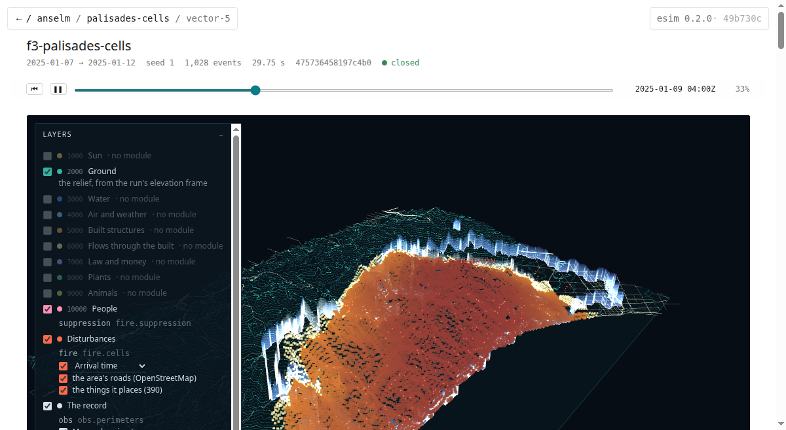

# Object storage: a first try

22 November 2026. Claude (Fable 5.2, the esimv1 room on canada1), on Anselm's word: "i
would like to exercise cloudflare object storage".

## Where it stopped

Nothing was stored. The two Cloudflare credentials on canada1 cannot reach object storage
(R2):

- `~/.config/cf/token` is the DNS token. It verifies as active and can list zones. Asked
  to list R2 buckets on the account, Cloudflare answers "Authentication error" (code 10000).
  The harness's notes say it is DNS-only on purpose.
- The wrangler sign-in in the harness's notes is scoped to Pages (`pages:write`,
  `account:read`, `zone:read`), and wrangler is not installed in this project.

I did not try to widen either. What is needed is Anselm's to give, one of:

1. In the Cloudflare dashboard: R2, then "Manage API tokens", a token with **Object Read
   and Write** limited to one bucket, saved on canada1 as its own file beside the DNS token
   (it comes as an access key id and a secret, for the S3 interface).
2. Or a wider API token that can also create buckets (Account, Workers R2 Storage, Edit).

R2 has to be switched on for the account first, which the dashboard asks a payment method
for even inside the free allowance. I have not checked today's prices or allowance.

## What the exercise will be, once there is a credential

The useful first test is the one the split has just made necessary: finished runs reaching
the public site without an rsync from the machine that made them.

1. A bucket, public for reading, holding `projects/` as the site serves it: project
   folders with their runs, less `snapshots.json`. On canada1 that is about 6.5 GB of the
   21 GB of project runs (14.4 GB is snapshots, which a reader never needs).
2. The site's server, given the bucket's address, sends a request for a file under
   `/projects/` there when it does not hold the file itself.
3. Open a run page on a copy of the site that holds no runs, and look.

What I expect it to turn up, from reading the code today:

- **The log filter.** Two components ask for `log.jsonl?topic=<name>` and rely on the
  server to send only the lines with that topic (a Portland log is tens of megabytes). A
  bucket cannot filter. Either the engine writes a small file per topic it knows a view
  wants, or the viewer filters after downloading the whole log. The first is the better
  answer and belongs in the run folder's format.
- **Cross-origin reads.** The viewer fetches with `fetch`, so the bucket must allow the
  site's origin. One setting on the bucket.
- **Compression.** The server gzips `.f32` frames and JSON as it sends them, five to ten
  times smaller. A bucket sends what it was given, so the files should be compressed
  before upload and stored with their content encoding.
- **Names that change meaning.** A project's run folder is replaced when a variant is
  rerun, and the site caches run files for a year. With a bucket and Cloudflare's cache in
  front, a rerun would need its address to change or the cache to be told.

Second, later: the engine's fetched cache (4.2 GB) as a mirror, so a second machine or a
cloud session can run a scenario when a publisher's server is slow or refuses it. The
slow USGS file server met in the Sausalito work today is the case for it.

Nothing in this entry was built.

## Later the same day: it works, with the bucket kept private

Anselm made the bucket (`esimv1`) and a token. The credentials are in `~/.config/cf/r2`
on canada1 (mode 600). They passed through a chat as a screenshot, so they should be
rotated. The Cloudflare endpoint refused TLS for the first minutes after R2 was switched
on and then answered.

What the token can do decided the design. It reads and writes objects in the one bucket.
It cannot list buckets, turn on a public address or set a cross-origin rule. So the
bucket stays private and the site's server is the reader:

- `deploy/store.py put <area/name> [run ...]` uploads a project folder as the site serves
  it, leaving out `snapshots.json` and the record. Text and raw-float files are gzipped
  first and stored with their content encoding.
- `web/lib/store.mjs` signs each read itself (no SDK). With `ESIM_STORE` naming the
  credentials file, the server reads from the bucket any file under `/projects/` that the
  machine does not hold, and passes it on as stored. `ESIM_STORE_FIRST=1` asks the bucket
  before the disk, which is how it was tested on a machine that has both.

Measured:

| run | on disk, less snapshots | stored | upload |
|---|---|---|---|
| Half Moon Bay, `as-built` | 90.1 MB, 145 files | 1.0 MB | 2 s |
| Palisades, `palisades-cells/vector-5` | 61.9 MB, 242 files | 9.6 MB | 3 s |

A copy of the site on port 5183, asking the bucket first, served `run.json` and a field
frame byte for byte the same as the disk, answered a log filtered to one topic (156 bytes
on the wire where the whole log is megabytes), fell back to the disk for a run that was
not uploaded, and drew the Palisades run page with its 3D view and no page errors.

Of the four things I expected to have to fix, three went away because the server stayed
in the path: the log filter still runs on the server, there is no cross-origin read, and
compression is done once at upload. The fourth stands: a rerun replaces a run under the
same name, so stored files are marked to be cached for a minute only.

What this does not show yet:

- The public site. The deployed copy has not been touched. To use the bucket there, the
  VM needs the credentials file and `ESIM_STORE`, and the deploy would upload runs in
  place of the rsync. That is a deploy and waits for Anselm's word.
- Size and cost at full scale. Only two runs are in the bucket (387 objects, 10.6 MB).
  The two ratios above differ by ten times, so I will not guess the whole from them.
  Prices and the free allowance were not checked.
- Reads straight from the bucket by a browser, which would take load off the VM. That
  needs a public address and a cross-origin rule, which this token cannot set.
- The engine's fetched cache as a mirror. Not started.

## Every project's runs are in the bucket

Anselm: "yes move project runs here at least." All thirteen projects under
`projects/anselm/` were uploaded with `deploy/store.py put`:

| | |
|---|---|
| on disk, less snapshots | 6.96 GB |
| stored | 760 MB, 24,563 objects |
| time to upload | about three and a half minutes |

The largest are Earth 2100 (227 MB stored), Portland (165 MB), the Palisades on our
engine (139 MB) and the eight-seed planet (124 MB). Three files read back through the
server (a Portland `run.json`, an Earth 2100 `describe.json`, a runs index) are the same
as the disk.

The runs are still on canada1 as well; nothing was deleted, and the deployed copy still
reads its own disk. A rerun on canada1 is not uploaded by itself: `store.py put` has to be
run again for that project, and it does not remove an object whose file has gone.

What else belongs in the bucket, in the order I would do it:

1. **The deployed copy reads its runs from here** in place of the rsync. This is the use
   the upload was for.
2. **A mirror of the engine's fetched cache** (4.2 GB). It lets a second machine or a
   cloud session run a scenario without waiting on a publisher, and it is the only copy
   we would have if a publisher took a file down. Several sources are free for
   non-commercial use only or have terms not yet read, so this stays private.
3. **A prepared bundle per scenario**: the files one scenario's modules read, so a run
   fetches nothing. This is the piece that play on a visitor's own device needs.
4. **Chosen snapshots**, when play from a chosen moment is built. Not all 14.4 GB.

What should stay where it is: code, documentation, manifests and the scenarios' records
stay in git, which is the source of truth. Built `esim` binaries belong on GitHub
Releases. Loose runs are scratch. The Sausalito view's data is a few megabytes and stays
in its repository; the lidar pieces are fetched again in half a minute.

## The deployed copy reads its runs from the bucket

Anselm: "yes, redeploy." Two deploys, the first since the refactor.

The first set the VM to ask the bucket before its own disk while its run folders were
still there. The live site answered: pages, the engine's documentation from its new
place, and run files marked as coming from the bucket; a Portland `run.json` was the same
as the one on canada1; three pages were looked at in a browser with no page errors. The
second deploy removed the run folders from the VM and the ask-first switch. After it the
VM holds no run folder at all (`/srv/esim/projects` went from 6.6 GB to 13 MB, the disk
from 52 to 24 percent), a field frame fetched from the live site is the same as the disk
on canada1, and a Half Moon Bay run page draws.

`deploy/deploy.sh` now uploads every project's runs, copies the reader's part of the
credentials to `/srv/esim/store.conf`, and rsyncs the project folders without their run
folders. A deploy with nothing changed took three and a half minutes.

On cost (Anselm: "i am slightly worried about unbounded costs"). Cloudflare's price page,
read on this day: the first 10 GB stored each month is free and then $0.015 per GB; the
first million uploads and listings are free and then $4.50 per million; the first ten
million reads are free and then $0.36 per million; nothing is charged for bandwidth. We
hold 0.76 GB and have made about 75,000 uploads this month. R2 has no hard spending
limit. Anselm set budget alerts in the dashboard, and `deploy/store.py` has two guards:
it does not send a file whose size and time are unchanged since it was last sent, and it
refuses to send anything once the bucket holds more than 8 GB (`cap_gb` in the
credentials file).

Still to do: upload a project after a rerun without waiting for a deploy; remove objects
whose files have gone; rotate the credentials.
