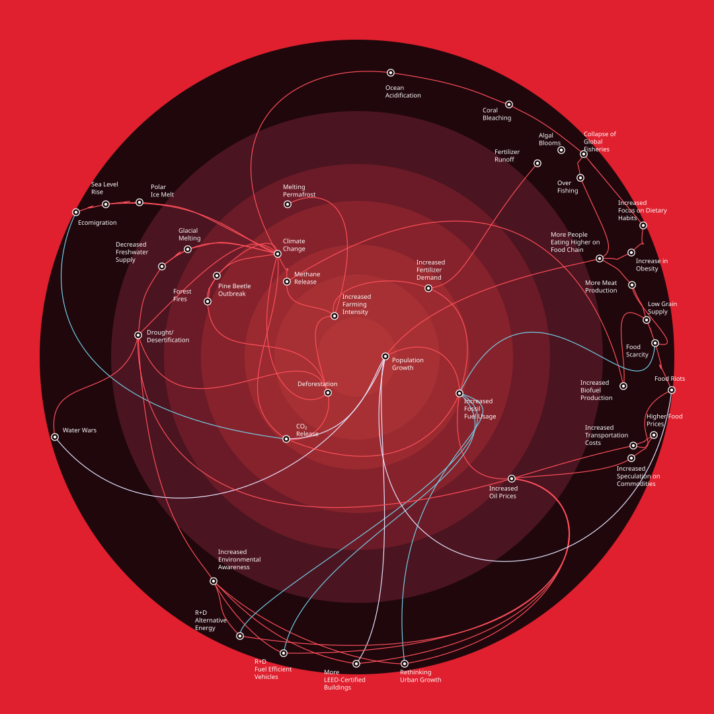

<!-- order: 18 -->
<!-- section: Telling it -->
# Telling a scenario

A run is a folder of numbers. A project page is where a person who was not there finds out
what the numbers are about, and most readers are novices to the topic in front of them, or
to simulation, or to both. These are the practices the first projects settled on for that
page. They are conventions, not code; the code enforces only that a figure's numbers come
from the runs.

## Three parts, and the simulation is the middle one

A scenario is a situation, and a situation has a before and an after. The page covers all
three.

- **How the ground was primed.** The deep history, as far back as the record allows: for a
  fire, the charcoal in offshore mud for six centuries, the county's fire maps for one, the
  policies that changed and the ones that did not; for the planet, the emissions and the
  record since 1850. The reader learns what is ordinary about the event before learning what
  is not. [The Palisades fire](/anselm/palisades-2025) has a section called *The ground before
  the fire*.
- **The event.** What the record says and what the runs say, side by side, with the measures
  that compare them, and what each run gets wrong said in the same breath as what it gets
  right.
- **What it changed.** The reviews, the law, the market, the rebuilding, the court. This is the
  part most easily left out and the part a citizen most needs; it is also the part whose
  numbers go stale fastest, so it carries its as-of date in the first sentence.

The reporting that goes into the first and third parts is sourced like anything else here:
named, dated, and marked *recalled* where it was not read. Casual research is allowed and says
so.

## The human model beside the machine model

Every run page draws the wiring of the modules in the manifest. That picture is true and
nobody at the event thinks that way. A person at a fire thinks in wind, fuel, slope, houses
and crews; a person at the climate thinks in emissions, sinks, warming and thresholds. So
the project page carries a second picture, the actors and the relationships between them in
the words a person would use, drawn from an `actors` block in the README (the vocabulary is
in [Projects and runs](/docs/system/projects-and-runs)).

Two rules for it. The human model's standard is agreement: it should rest on the frameworks
the field already teaches, named on the page, so a fire officer, an ecologist and a resident
would draw much the same picture. And it is not the simulation. A solid arrow is a
relationship the runs model and a dashed one is a relationship the world has and the runs
lack. The gap between the two pictures is an object of the project: looked at arrow by
arrow and closed with a module or explained on the page, never hidden by drawing the smaller
picture. The two may never fully meet, and that is allowed.

There are other kinds of human picture, and not every scenario wants every kind. The one
below is a cascade: a core issue at the centre and its knock-on effects radiating outward,
each ring one step further removed, the colour of a line saying what kind of chain it is. It
answers "and then what?", which the actors figure does not, and it suits a planet-scale
scenario better than a single fire. It was drawn by alwayswithhonor.com and is reproduced
here as Anselm supplied it on 2026-11-04; the actors figure on the Earth 2100 page breaks
out the knock-on contributors in the same spirit, with the model's gaps dashed.

The cascade belongs to a longer line of drawn networks. Anselm points to Ben Fry's essay
*Learning from Lombardi* (medium.com/@ben_fry) on Mark Lombardi, whose pencil drawings of
money and influence were made from thousands of index cards and are read as pictures
before they are read as data; Fry's point, as Anselm relays it, is that the hand-made
arrangement is part of the argument. The essay was not read for this page, since Medium
refused the fetch. Beyond it lies the whole field of information graphics and visual
storytelling, which is older than simulation and better at readers; the pages here borrow
from it and do not pretend to add to it.

## The story carries the reader

The tool is an appliance, and an appliance is not an explanation. The project page is a
story in the plain sense: it begins with the place and the people, goes through what
happened, and ends with what it changed and what the model cannot say. Figures sit in the
story where their numbers are needed and nowhere else. The register is sober, the numbers
are the runs', and the philosophy, where there is any, is at the top and the bottom and not
threaded through the tables. The essay this draws on is Anselm Hook's *Computational
journalism* (2026): "we need stories AND models, we need a visceral emotional connection AND
some grounding."

## What a project page has, as of November 2026

- A title that is a sentence a reader would say, and a first paragraph that says what the
  page is, who wrote it and when, and that nothing on it is a forecast.
- The priming, the event, the aftermath, each with its sources.
- The actors figure, on named frameworks, with the gaps dashed.
- The runs' own figures: the ladder or the tables, drawn as the page is read.
- A closing section on what the page cannot tell you, and a link to
  [Limits today](/docs/system/limits).

## The reading list

A project page ends with what it has read: each article or dataset the page rests on, the day it was
read, what was taken from it, and which numbers are only recalled and not yet checked against their
source. Newest first. A reader can then tell the sourced from the remembered without opening the
describes, and the next article to arrive has a place to go (Anselm, 2026-11-08: "we probably should
track these articles in the readme"). Earth 2100's *What this page has read* is the first.
